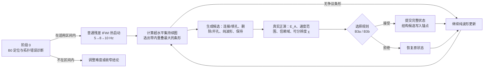
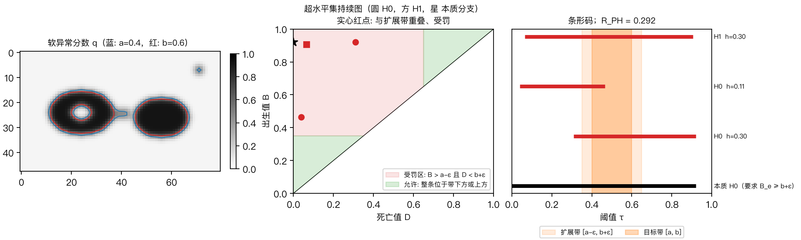

# 拓扑先验与物理一致性审查协同的隐式全波形反演研究

**研究项目书 v0.2**（2026-10-21，在 v0.1 基础上按评估意见修订）

> 标注 **【待核实】** 的文献须在提交前逐篇核对出处；标注 **【待填】** 的内容依赖项目周期、人员和算力来源，本稿无法确定。第 8.2 节为本稿随附最小实验的实测结果，代码见 `topo_ifwi/`。

## 修订说明（v0.1 → v0.2）

| 编号 | 修改 | 所在章节 |
|---|---|---|
| 1 | 新增阶段 0：先确认普通 IFWI 在目标带内确有拓扑错误、且已定位主体，再进入方法研究 | 2.2、6.2、7.1 |
| 2 | 统一候选接受规则：数据平局时由先验决定（B3a）与保留纯波形（B3b）拆成两组对照 | 4.6、5.3、6.3 |
| 3 | 软异常场的阈值与温度改为相对对比度定义；v_ref 带深度梯度；补争议条形选择规则 | 4.2、5.2 |
| 4 | 补水平集 FWI、非对称 TV/hinge 约束等相关工作，新增 B5 对照 | 1.3、6.3 |
| 5 | 补算力预算；正演改为 2 ms、3 s；阶段 C 缩小规模 | 6.1、7.2 |
| 6 | 正演改为四阶空间差分；观测数据在两倍加密网格上生成 | 4.1、6.1 |
| 7 | 命题 4–6 降为"设计性质"；新增数据可分辨度的必要条件（命题 4） | 第四章 |
| 8 | 主要指标改为 IoU、HD95、异常区 RMSE；Betti 误差降为次要指标；写明阈值登记时点 | 6.4、6.6 |
| 9 | 写明 PH 实现：并查集与对偶、连通性约定、关键像素取值 | 5.5 |
| 10 | 研究对象统一为"盐体类高速异常体"，实验加入高对比度与盐下弱照明设定 | 摘要、6.2 |
| 11 | 补进度安排、研究基础与条件（人员、经费为【待填】） | 7.3、第八章 |
| 12 | 摘要前置预期贡献；限定语集中到 2.2 与 7.4 | 全文 |
| 13 | 新增技术路线图与阈值带损失示意图 | 3.4、4.3 |
| 14 | 补盐体成像难点文献 | 1.1 |

## 摘要

盐体等高对比度高速异常体的全波形反演（FWI）常出现主体断裂、伪孤岛、伪孔洞和虚假桥接。这些结构错误对全局均方误差贡献不大，却直接影响边界解释和后续成像。本项目以残差式正弦隐式神经网络（SIREN）表示速度场，把"异常体是一个连通、无孔的主体"这类弱结构知识写成可计算的持续同调约束，并用真实正演对拓扑修正逐项审查。

预期贡献有三项：

1. **可达的阈值带拓扑损失。** 不再要求单位寿命，而是要求异常分数的超水平集在一个带裕量的阈值带内保持预期的 Betti 数。该损失的零集可达，带内拓扑由零损失严格保证（命题 1），并用寿命乘子消除条形跨带时的梯度平台。
2. **显式区分"连接"与"删除"的候选审查。** 拓扑梯度对同一个多余分支同时给出抬高鞍点（连接）和压低峰值（删除）两个方向。本项目把两者分解为独立候选，用实际网络输出的非线性正演检验，并用数据可分辨度（命题 4）判断数据何时足以裁决。
3. **把先验信息与搜索算力分开的对照设计。** 通过 B3a/B3b（数据平局时是否由先验裁决）和 B4（同等候选与正演预算的纯波形搜索），分别测量拓扑先验带来的结构信息、审查带来的保护以及额外搜索的作用。

研究先在阶段 0 确认方法的适用区间："普通 IFWI 已定位主体，但目标带内仍有拓扑错误"。之后在小规模二维声学模型上完成对照、错误先验压力测试和算力配平，再决定是否扩展到复杂模型和学习型审查器。随附的最小实验已经跑通完整流程，第 8.2 节给出实测结果。

**关键词：** 隐式全波形反演；持续同调；拓扑先验；物理一致性；候选审查；盐体类高速异常体

## 一 研究背景与问题提出

### 1.1 从波形拟合到结构可信度

全波形反演通过波动方程把地下参数与地震观测联系起来，能够恢复高分辨率速度结构[13]。对盐体等高对比度异常体，FWI 面临三类公认困难：缺少低频时初始模型误差引起周波跳跃；盐体上界面强反射使盐下照明不足；高速体内部与底界面的波场覆盖有限。结果是，速度模型可以在波形残差很小的同时，保留窄颈断裂、零散高速块、孔洞和虚假桥接。这些局部形态错误对全局均方误差贡献很小，却决定边界解释和后续偏移成像的质量。

需要明确的是，拓扑先验不能修正运动学错误。若异常体的位置或埋深本身错了，"单一连通主体"的约束只会把错误的位置连起来。因此本项目只针对一个特定区间：普通反演已经定位主体，但连通性和孔洞仍有错误。这个区间是否存在、有多宽，由阶段 0 实测确定（2.2 节）。

隐式全波形反演用坐标网络参数化速度场[10]，SIREN 的周期激活为连续表示提供了基础[1]。网络改变了速度场的搜索方式，但不会补足观测缺失的信息。本项目以普通残差 IFWI 为主干，考察结构先验能否带来可验证的增益。

常用的平滑或 TV 约束作用于局部差异，难以表达"一个连续主体""主体内部没有孔洞"这类整体要求。结构导向正则化已经体现了地质几何信息的价值[6]。本项目关注更弱的结构知识：异常体的精确边界未知，但它的连通关系在独立地质信息支持下较为明确。

### 1.2 渗流启发与持续同调表达

渗流问题研究局部占据如何形成全局连通结构。对本项目的启发是：解释速度异常时，应关注整个阈值扫描过程中的结构演化，而不只是单个像素是否超过某个阈值。为此，把连续速度场映射为软异常分数，随阈值变化构造超水平集，追踪连通分支和孔洞的出现、合并与消失。

本研究不假设地下速度场服从独立占据、普适临界指数或经典随机渗流模型。渗流只提供问题视角，持续同调提供计算工具。持续长度衡量结构跨越的分数阈值范围，不能直接解释为空间尺寸或地质可信度：高对比度噪声点也可能寿命较长。

Clough 等用 Betti 数先验构造拓扑损失，并用于图像分割[2]；持续图稳定性定理[3]和持续同调函数的优化理论[4]分别提供了扰动分析与梯度计算基础。拓扑信息在波动方程反问题中的收益仍需单独验证。

### 1.3 与已有研究的关系

**直接控制盐体形状和连通性的反演方法。**
- 参数化水平集 FWI 用一组基函数系数表示盐体边界，形状与拓扑由水平集隐式控制[11]【待核实】。
- 非对称 TV 和 hinge 约束利用"盐体速度高于围岩"的单侧信息修正盐体[12]【待核实】。
- 拓扑优化方法用材料插值描述盐体分布[7]。
- 工业流程中的 salt flooding 由解释人员逐层填充盐体，再用 FWI 校正。

这些方法的"拓扑"与形状参数化或材料插值绑定。本项目的区别有三点：
1. 不改变速度场的参数化，拓扑约束作为附加项加在普通 IFWI 上；
2. 直接约束阈值集合的连通分支和孔洞，并给出带内 Betti 数的零损失保证；
3. 每次拓扑修正都要经过真实正演审查，数据不支持时可以拒绝。

为说明这些区别是否带来实际收益，实验中设置水平集或非对称 TV 对照（B5，6.3 节）。

**学习型与带保护机制的优化。** 学习型正则化表明可以从样本分布学习重建先验[5]；带保护机制的学习优化说明，把建议更新与可检验条件结合有方法价值[8]。有关凸优化的结论不能直接移植到非凸的 IFWI。

**研究定位。** 本项目建立"候选生成—真实正演—约束筛选—状态回滚"的闭环。潜在创新来自三者的协同：可达的阈值带损失、显式的连接/删除分解与物理审查、隐式参数化下的完整状态管理，而非单独使用持续同调或神经网络。新颖性仍需在系统文献检索中核实。

## 二 研究目标、适用区间、科学问题与假设

### 2.1 总体目标

建立一个可以附加在普通 IFWI 上的结构修正框架。在先验来源明确、数据误差可接受、计算成本可控的条件下，减少错误断裂、伪孤岛和孔洞，同时识别不应进行拓扑修正的情形。输出包括速度结果、候选选择记录、先验适用性说明和失败案例，而不只是一幅拓扑更整齐的图像。

### 2.2 适用区间与阶段 0

方法只在以下区间内有意义：
- **已定位：** 普通 IFWI 结果的本质分支覆盖目标带（B_e ≥ b+ε），且异常区 IoU 不低于预先登记的下限；
- **有错误：** 目标带内的 Betti 数与真值不一致。

两个条件缺一不可。前者不满足时拓扑先验无从着力，后者不满足时没有可修正的对象。阶段 0 只运行 B0，在开发模型上统计这两项。不满足时依次调整低频截止、异常体对比度、初始模型平滑程度和炮数，直到找到这个区间，或者确认它在给定条件下不存在。后一种情况本身就是结论，项目据此收窄。

### 2.3 核心科学问题

**第一，拓扑先验提供的信息是否与波形约束互补？** 区分"拓扑指标改善"和"速度及边界恢复改善"，检验前者能否在独立测试模型上转化为后者。

**第二，如何区分连接与删除？** 同一个多余连通分支，既可以通过抬高连接鞍点消除，也可以通过降低孤岛峰值消除。两种操作都能降低拓扑损失，地质含义却相反。需要判断波形数据在什么条件下足以支持其中一种（命题 4）。

**第三，物理审查能保障什么？** 审查器可以验证实际候选的波形残差、参数边界和更新幅度，却无法单凭同一组数据证明候选等于真实模型（性质 3）。研究明确这一边界，并在不确定时保留原状态。

### 2.4 待检验假设

- **H1：** 在 2.2 节的适用区间内且先验正确时，阈值带拓扑约束能降低结构错误，并在部分困难条件下改善边界和速度误差。
- **H2a：** 相对于无审查的拓扑更新（B2），物理审查（B3a、B3b）能降低错误连接和误删主体的发生率，且在配平正演次数（B4）后仍有收益。
- **H2b：** 在数据无法区分候选时，由先验裁决（B3a）比保留纯波形（B3b）带来更多正确的结构修正。若 B3a ≈ B3b，说明收益主要来自审查的保护作用，而不是先验信息。
- **H3：** 错误先验、缺失异常和弱照明条件会显著降低拓扑修正的可靠性；拒绝与保持机制能够减少但无法完全消除这种风险。

若实验只显示拓扑指标改善，而主要重建指标退化，或收益主要来自额外计算，则收窄方法结论。

## 三 研究内容与技术路线

### 3.1 研究内容一：可达拓扑先验的构造与诊断

构建速度到软异常场的固定映射，明确背景、阈值和温度参数的来源。实现超水平立方复形及本质零维分支处理。设计覆盖目标阈值带的损失，并通过解析小图、标签计数交叉核对和有限差分，验证损失、配对和梯度。

### 3.2 研究内容二：隐式反演与候选物理审查

把拓扑损失加入残差 SIREN 反演，研究它对速度场和网络参数更新的影响。针对争议结构生成连接、删除和纯波形候选，逐一评价实际网络输出。以噪声容限、速度范围和信赖域为约束完成选择，保留普通更新和当前状态作为安全退路。

### 3.3 研究内容三：受控验证与失效边界识别

采用小规模合成实验、配平计算量的对照和独立测试模型，分析方法随噪声、采集孔径、先验错误和网络表示变化的表现。先建立非学习审查器的可行性；若其效果稳定而候选评估成本较高，再用学习型排序减少无效候选，不提前承担额外训练成本。

### 3.4 技术路线

## 四 数学模型与理论推导

### 4.1 波动方程与残差隐式表示

采用二维常密度声学模型。对第 s 炮，波场满足

$$\frac{1}{v(x)^2}\partial_t^2 u_s-\nabla^2 u_s=f_s,\qquad d_s=P_s u_s+\eta_s .$$

离散采用时间二阶、空间四阶有限差分，四周为二次型阻尼吸收层。同一实验内源项、接收算子和边界条件保持一致。观测数据在两倍加密的网格上生成（空间与时间步长各减半），反演在原网格上进行，避免"反演犯罪"。记离散正演为 F，观测为 d，波形损失采用训练炮集 A 上的归一化残差

$$E_A(v)=\frac{\sum_{s\in A}\|W_s(F_s(v)-d_s)\|_2^2}{\sum_{s\in A}\|W_s d_s\|_2^2}.$$

W 为预先确定的频带或时间窗，不能根据测试真值调整。参数化采用 $v_\theta(x)=v_0(x)+f_\theta(x)$：v0 为独立初始背景，f 为 SIREN 残差，输出层初始化为零，使第 0 步恰为 v0。

### 4.2 软异常场及先验来源

定义软异常分数

$$q_\theta(x)=\sigma\!\left(\frac{v_\theta(x)-v_{ref}(x)-\Delta v}{T}\right),\qquad \sigma(r)=\frac{1}{1+e^{-r}} .$$

**参数按相对对比度确定。** 记先验异常速度为 $v_{anom}$（来自独立地质信息，例如盐速），先验深度范围内参考背景的平均速度为 $\bar v_{ref}$，对比度 $c=v_{anom}-\bar v_{ref}$。取

$$\Delta v=\rho\,c,\qquad T=\gamma\,c,$$

初始建议 ρ = 0.5、γ = 0.1，在开发集上冻结。固定的小阈值（如 v0.1 的 200 m/s）远小于盐体约 2000 m/s 的对比度，会把 FWI 在边界附近的过冲旁瓣、SIREN 的高频纹理和深部沉积层都计为异常。

**v_ref 必须带深度梯度。** 否则随深度增大的沉积层速度会整体越过阈值。v_ref 来自独立背景模型；若采用深度相关背景，应说明它来自测井、已有低分辨率模型还是预先给定的合成背景。

在固定、矩形的物理区域 Ω 上构造超水平集 $\Omega_\tau=\{x:q(x)\ge\tau\}$，排除吸收边界。条形记为 $(B_i,D_i)$，$B_i\ge D_i$，阈值 τ 满足 $D_i<\tau\le B_i$ 时存活。保留唯一的本质 H0 分支，约定 $B_e=\max q$，$D_e=0$。

### 4.3 阈值带覆盖损失

若直接令期望分支寿命趋近 1、采用 $1-\ell^2$ 型项，有限 sigmoid 输出导致 $\ell_e=\max q<1$，该项不能取零；把它的零水平集当作可行集会产生空集问题。本项目采用阈值带重叠损失。选择 $0<a-\varepsilon<a<b<b+\varepsilon<1$，对每个有限 H0/H1 条形定义

$$h_i=\big[\min(B_i,b+\varepsilon)-\max(D_i,a-\varepsilon)\big]_+,$$

$$R_{PH}(q)=\big[b+\varepsilon-B_e\big]_+^2+\sum_{i\in I_0^{fin}\cup I_1^{fin}} h_i^2\,(1+\kappa\,\ell_i^2),\qquad \ell_i=B_i-D_i,\ \kappa>0 .$$

首项要求本质分支覆盖目标阈值带，其余项消除有限条形与扩展阈值带的重叠。

**寿命乘子 1+κℓ² 的作用。** 当 $B_i>b+\varepsilon$ 且 $D_i<a-\varepsilon$ 时，$h_i$ 固定为 $b-a+2\varepsilon$，单独 $h_i^2$ 对端点的梯度为零。加入乘子后，对 $B_i$、$D_i$ 的导数分别为 $2\kappa h_i^2\ell_i$ 与 $-2\kappa h_i^2\ell_i$，恢复了"降低峰值"和"抬高鞍点"的下降方向。乘子始终为正，不改变零值条件；κ 只在开发集选择。

*图 1 阈值带损失示意。左：含伪孔洞、弱颈部和伪孤岛的软异常场；中：超水平集持续图，红色区域内的条形受罚；右：条形码与扩展带。由 `topo_ifwi/figures.py` 生成。*

**命题 1（阈值带拓扑保证）。** 在上述复形与本质分支约定下，若 $R_{PH}=0$，则任意 $\tau\in[a,b]$ 的超水平集均有 $\beta_0=1$、$\beta_1=0$。

*证明要点。* 首项为零给出 $B_e\ge b+\varepsilon$，且 $D_e=0<a$，故本质分支在带内始终存活。任一有限条形若在目标带内存活，将与扩展带产生正长度重叠，与 $h_i=0$ 矛盾。∎

该零值在分数空间可达，例如取常数 $q>b+\varepsilon$。但这个例子对应完全前景，说明拓扑约束无法独立恢复形状。实际软惩罚仅取得小值时，不自动获得精确的 Betti 数保证，必须直接扫描阈值验证。

### 4.4 稳定性与局部梯度

**命题 2（固定映射下的持续图稳定性）。** 对相同的 v_ref、Δv、T 和固定有限复形，由 sigmoid 导数的上界和持续图稳定性[3]，有

$$d_B\big(\mathrm{Dgm}(q_1),\mathrm{Dgm}(q_2)\big)\le\|q_1-q_2\|_\infty\le\frac{\|v_1-v_2\|_\infty}{4T}.$$

该式说明输入的小扰动不会造成任意大的持续图变化。它没有给出由拓扑相似反推速度接近的逆不等式。

**命题 3（固定配对区域内的梯度）。** 当滤过值无关键并列、持续配对及 min/max 的活动分支不变时，$R_{PH}$ 对相关分数分段可微，例如 $\nabla_\theta\ell_i^2=2(B_i-D_i)(\nabla_\theta B_i-\nabla_\theta D_i)$。梯度只经过各条形的出生像素和死亡像素。配对切换和阈值折点处采用确定性的次梯度规则，并记录并列处理。

**方向歧义。** 对多余的 H0 条形，降低出生峰值可删除孤岛，抬高死亡鞍点可连接分支，两者都能缩短寿命。分数空间的梯度集中在少量关键像素，网络参数梯度为 $J_\theta^\top g$；在普通梯度步的一阶近似下，速度变化涉及 $J_\theta J_\theta^\top g$，可能扩散到远处。Adam 的动量和预条件会进一步改变实际方向。这是第 5.2 节把两个方向显式分解为候选的原因。

### 4.5 数据可分辨度（新增）

对候选 $v_1,v_2$，记 $N=\sum_s\|W_sd_s\|^2$，$r_k=W(F(v_k)-d)$，$E_k=\|r_k\|^2/N$。定义可分辨度

$$\chi(v_1,v_2)=\frac{\|W(F(v_1)-F(v_2))\|^2}{N\,\tau_t},$$

其中 $\tau_t$ 为数据平局容差（5.3 节）。

**命题 4（可分辨的必要条件）。**

$$|E_1-E_2|\le\sqrt{\chi\,\tau_t}\,\big(\sqrt{E_1}+\sqrt{E_2}\big).$$

因此，数据能区分两个候选（$|E_1-E_2|>\tau_t$）的必要条件是

$$\chi>\frac{\tau_t}{(\sqrt{E_1}+\sqrt{E_2})^2}.$$

*证明。* $E_1-E_2=\langle r_1-r_2,\,r_1+r_2\rangle/N$，由 Cauchy–Schwarz 不等式与三角不等式即得。∎

在线性化近似下 $F(v_1)-F(v_2)\approx J(\delta_1-\delta_2)$，χ 衡量"连接"与"删除"两种修正之差在观测中的照明程度。盐下或深部弱照明区的 χ 很小，此时数据无法裁决，选择只能来自先验（B3a）或保持纯波形（B3b）。χ 在每次审查中由候选的实际正演直接算出，不需要额外计算，实验逐次记录。

### 4.6 物理审查的设计性质

以下三条直接由定义或初等不等式得出，作为设计性质列出，用于说明审查器能保证什么、不能保证什么。

**性质 1（可行集保证）。** 记候选集合为 $C_t$，每个元素是实际网络输出及其完整优化器状态，当前状态也是一个显式候选。定义可行集

$$\mathcal A_t=\{v\in C_t:\ v_{min}\le v\le v_{max},\ \|v-v_t\|_\infty\le r_t,\ E_A(v)\le\min(E_A(v_t)+\tau_t,\,E_{max})\}.$$

若当前状态可行且只从 $\mathcal A_t$ 中选择，则 $E_A(v_{t+1})\le E_{max}$ 且 $E_A(v_{t+1})\le E_A(v_t)+\tau_t$。去掉绝对上限后，n 次迭代只能得到 $E_A(v_n)\le E_A(v_0)+\sum\tau_t$，容限可能累积。该保证只针对所用的离散正演、观测集合和误差度量，对真实速度误差、未观测炮或地质正确性均无直接保证。

**性质 2（实际修正的误差恒等式）。** 设纯波形候选为 $v_w$，审查候选为 $v_c$，$\delta=v_c-v_w$，$e=v_w-v^*$，则

$$\|v_c-v^*\|_2^2-\|v_w-v^*\|_2^2=2\langle e,\delta\rangle+\|\delta\|_2^2 .$$

因此误差改善当且仅当 $\langle e,\delta\rangle<-\|\delta\|^2/2$。该式适用于实际 SIREN/Adam 产生的速度；真值只用于合成实验的事后诊断，不能进入候选接受规则。

**性质 3（不可辨识限制）。** 若两个模型满足相同先验且 $F(v_1)=F(v_2)$，则任何仅依赖这些数据和先验的确定性输出 $\hat v$，至少对其中一个模型满足 $\|\hat v-v\|\ge\|v_1-v_2\|/2$。该结论明确了审查模块的能力边界，也是设置拒绝判断与保留状态的理由。

## 五 算法设计与实施要点

### 5.1 联合目标与分阶段激活

基础训练目标为

$$L(\theta)=E_A(v_\theta)+\lambda_{TV}R_{TV}(v_\theta)+\lambda_{PH}R_{PH}(q_\theta).$$

TV 与 PH 在消融中分别启用。先进行低频普通 IFWI（5→8→10 Hz 低通分段），使主要异常获得数据支持，再进入结构阶段。触发条件依据预定迭代阶段和本质分支是否覆盖目标带，不能借助测试真值。若异常尚未出现，拓扑梯度只会追逐当前的最大值，缺乏可靠的定位信息，应继续波形阶段。

### 5.2 候选生成

每次审查从同一个检查点分叉，每次只处理一个争议结构，避免组合候选数量爆炸。

**争议条形选择规则：** 取与扩展带重叠 $h_i$ 最大的有限条形。

**候选区域：**

| 条形类型 | 候选"抬高"（软目标 $q\ge b+\varepsilon+0.05$） | 候选"降低"（软目标 $q\le a-\varepsilon-0.05$） |
|---|---|---|
| H0 多余分支 | **连接**：以死亡鞍点为中心、半径 2 格的圆盘 | **删除**：在 $\max(D_i,a-\varepsilon)$ 水平上，含出生峰值的前景连通分量 |
| H1 孔洞 | **填孔**：在 $\min(B_i,b+\varepsilon)$ 水平上，含死亡极小值的补集连通分量 | **开孔**：以出生（闭合）像素为中心、半径 2 格的圆盘 |

软目标为区域内的单侧加权二次项，与波形目标一起做少量网络参数更新（n_inner 步）。候选幅度受速度信赖域限制，不能通过硬二值改图后直接提交正演。纯波形候选使用相同步数、相同步长和同一起点；保持候选不改变任何状态。候选的命名只表示备选方向，不代表已经确定真实结构应连接或删除。

### 5.3 非学习型审查器与选择规则

先检查全域速度范围、更新幅度和独立已知地质约束，再对实际 $v_\theta$ 做非线性正演。所有候选使用相同的炮集、频带和时间窗。最终接受不能只依赖线性化近似或局部像素变化。

统一的选择规则分三步：
1. **可行集** $\mathcal A_t$：按性质 1 的定义筛选。
2. **数据平局集：** $\mathcal T_t=\{v\in\mathcal A_t:E_A(v)\le\min_{\mathcal A_t}E_A+\tau_t\}$，其中 $\tau_t=\tau_{rel}\,E_A(v_t)$，τ_rel 在开发集确定。
3. **裁决：**
   - **B3a（先验裁决平局）：** 若 $\mathcal T_t$ 中有结构候选达到最小拓扑改善量（有限条形惩罚至少下降该条形贡献的一半），选其中更新幅度最小者。若平局集还含其他候选，记为"先验决定"，否则记为"数据决定"。若没有结构候选达标，选纯波形候选。
   - **B3b（平局保持纯波形）：** 只有当某个结构候选的残差比纯波形候选低 τ_t 以上时才接受它；否则选纯波形候选，并在平局集含结构候选时记为"不确定"。
   - 当前状态始终是显式候选；可行集只剩当前状态时保持不动。

被接受的结构候选，其软目标作为锚点保留到后续训练中。不确定判断的阈值在开发集确定，不能在测试失败后临时放宽。

### 5.4 权重设定规则

所有附加项的权重在阶段起点按梯度范数比确定：

$$\lambda=\rho_w\,\frac{\|\nabla_\theta E_A\|}{\|\nabla_\theta R\|}.$$

初始建议 ρ_PH = 0.5、ρ_TV = 0.5、软目标 ρ_soft = 2.0，在开发集冻结。这一规则只用当前状态，不用真值，并让不同模型间的权重具有可比的含义。

### 5.5 持续同调的实现

- **滤过：** 超水平集 $\{q\ge\tau\}$。前景采用 4 邻接；孔洞为补集在 8 邻接下不接触图像边界的连通分量。这一对偶约定使网格上的 Alexander 对偶成立[14]【待核实】。
- **H0：** 按 q 降序加入像素，用并查集合并，按"长者规则"记录出生峰值像素和死亡合并像素。
- **H1：** 由对偶性，计算 q 在补集上的升序零维持续，并加入一个比所有像素更老的虚拟边界节点。孔洞出生于使其与边界隔开的像素，死于其最小值像素。
- **可微性：** 每个条形保存出生与死亡像素的平面索引，在 torch 中按索引取 q 值，梯度只经过关键像素。
- **核验：** 实现已通过标签计数交叉核对、有限差分梯度检查和解析小图测试（8.2 节）。若改用 gudhi 等外部库，应先用同一组测试核对连通性约定。

在 96×128 网格上，一次持续图计算约 18 ms，远小于一次正演。

### 5.6 状态管理与学习型扩展

检查点包括网络参数、Adam 一阶与二阶矩、步数、学习率调度器、随机数状态及炮集采样状态。各分支独立克隆，接受时提交对应的完整状态，拒绝时恢复原状态，不能只回滚速度或网络权重。

学习型审查器作为可选扩展，输入候选速度、观测残差和采集几何，输出排序或风险分数。训练样本必须包含真实孤立体、错误连接、误删与域外结构，标签不能仅由拓扑损失自行生成。即便使用学习排序，最终的物理检查仍保留，其研究价值取决于能否降低实际总成本。

## 六 实验设置与评价方案

### 6.1 数值设置

以下为初始建议，需经稳定性、网格色散和运行成本验证后冻结，不代表最优超参数。

| 项目 | v0.2 设置 | 验证要求 |
|---|---|---|
| 物理网格 | 深度 96 × 水平 128，间距 20 m | 有效跨度 1.92 × 2.56 km |
| 正演 | 二维常密度声学；时间二阶、空间四阶差分 | 记录、伴随与边界测试 |
| 时间采样 | 2 ms（vmax = 4500 m/s 时 Courant 数 0.45，四阶格式稳定上限约 0.61） | 两倍加密网格对比 |
| 记录长度 | 3.0 s（最远偏移路径约 3.07 s，最慢垂直双程约 2.56 s） | 检查最慢路径与深部反射到时 |
| 观测数据 | 两倍加密网格（10 m、1 ms）生成，再按原网格抽取 | 报告建模误差下限 E_A(v_true) |
| 炮检配置 | 13 炮训练、4 炮留出评价；120 个接收点；源与检波器深 20 m | 均匀固定，避开吸收边界 |
| 源与频带 | 5 Hz Ricker；低通上限依次为 5、8、10 Hz | 统一滤波器 |
| 吸收边界 | 物理域外 20 格二次阻尼层 | 用无异常模型检查边界反射 |
| 网络 | 4 隐层、每层 128 单元的 SIREN，ω0 = 30，输出 ×1000 m/s，零初始化输出层；近地表锥形窗（前 4 行不更新，第 4–8 行余弦过渡） | 统一初始化与坐标归一化；锥形窗由采集深度预先确定 |
| 分数参数 | Δv = 0.5c，T = 0.1c（c 为先验对比度） | 开发集检验 |
| 拓扑带 | a = 0.4，b = 0.6，ε = 0.05，κ = 1，前景 4 邻接 | 同时报告 0.2–0.8 宽阈值扫描 |
| 训练预算 | Adam，学习率 2×10⁻⁴；热启动 600 步（每频带 200 步）；结构阶段学习率减半，300 步，每 20 步审查一次，候选内步 10 步、步长 3 倍 | 所有方法共享 |

在最高分析频率 10 Hz、最小速度 1500 m/s 下，最短波长约 150 m，相当于 7.5 个网格点。这对四阶差分足够，对二阶差分则会出现明显色散，因此 v0.1 的二阶方案改为四阶。

### 6.2 数据划分与难度标定

**拓扑单元测试**至少覆盖完整单体、断裂单体、伪孤岛、带孔体、偏移体、细桥、全前景、平坦场和高对比单像素。检查内容包括本质条形是否保留、空分支处理是否正确、关键梯度是否符合解析预期。

**合成模型族**由分层背景（含深度梯度与弱层理）加高速体（盐速 4300 m/s，对比度约 2000 m/s）组成。开发与测试按几何生成实例划分，同一模型的加噪版本不能跨集合分配。

- **阶段 0 / B：** 2 个开发模型和 2 个测试模型，3 个随机种子。
  - 开发模型含"细颈哑铃"：真实为单一连通主体，先验正确。
  - 开发模型含"两分离体"：先验错误，作为压力测试。
- **阶段 C：** 6 个开发模型和 6 个测试模型（v0.1 为 12 个），逐项引入：
  - 20 dB 加性噪声；
  - 炮数减半；
  - 低频截止（3 Hz 以下置零）；
  - 盐顶起伏和盐下目标（弱照明）。
  
  各项逐一加入，不做全因子组合。

**难度标定（阶段 0）：** 若 B0 在开发模型上不满足 2.2 节的两个条件，依次调整低频截止、对比度、初始模型平滑尺度和炮数，并记录每一档的定位率与带内 Betti 误差。标定只用开发模型。

### 6.3 对照组与公平性

| 组别 | 主要设置 | 回答的问题 |
|---|---|---|
| B0 | 普通残差 IFWI | 基线表现 |
| B1 | IFWI + TV | 局部正则化是否已经足够 |
| B2 | IFWI + PH，无审查 | 拓扑项的直接影响 |
| B3a | IFWI + PH 候选 + 物理审查，平局由先验裁决 | 完整方案的收益 |
| B3b | 同 B3a，平局保留纯波形 | 收益来自审查保护还是先验信息 |
| B4 | 纯波形多候选（步长 ×0.5/×1/×2）+ 同等审查预算 | 收益是否仅来自更多搜索与正演 |
| B5 | 参数化水平集 FWI 或非对称 TV/hinge 约束（阶段 B 末二选一） | 相对已有形状控制方法的增益 |

各组使用同一网络、源、初始背景和热启动检查点，分别报告"相同主训练步数"和"相近总墙钟/正演预算"两种比较。TV、PH、软目标权重与信赖域参数只在开发集选择。另在开发集上做 κ = 0 与 κ > 0 的小型消融，检查长条形的梯度平台及修正代价，不据此增加测试集调参机会。

### 6.4 指标与压力测试

**主要指标（预先登记）：**
- 异常区 IoU：q ≥ 0.5 掩膜，与真值同一映射；
- 边界 HD95（m）；
- 异常区 RMSE：真值掩膜外扩 3 格；
- 全域 RMSE：防止背景面积掩盖局部退化。

**次要指标：**
- 目标带（9 个阈值）和宽带（0.2–0.8，13 个阈值）内的 Betti 误差。B2/B3 直接优化这一指标，只能作为辅助证据。

**数据指标：** 训练残差、留出炮评价残差、建模误差下限。

**审查日志：**
- 每次审查的争议条形、候选残差与可行性、可分辨度 χ、决定类别（数据决定/先验决定/不确定/回退）；
- 用性质 2 事后判断被接受更新是否比纯波形候选更接近真值。该信息不反馈给审查器。

**计算指标：** 前向加反向次数、仅前向评估次数、PH 时间、峰值显存、总墙钟。

**错误先验：** 必须设置三类。
1. 真实存在两个分离异常体，却强加单体先验；
2. 真实无异常，却要求存在主体；
3. 背景偏差导致异常分数整体偏移。

另以细颈、真实孤立块和弱照明区检验误连与误删风险。二维切片的连通性不能直接继承三维地质体的连通性，三维先验不得未经论证用于二维实验。

### 6.5 判定原则与登记时点

阶段通过需要同时满足：
- 结构改善在多个种子和阈值下存在；
- 主要指标无系统性退化；
- B3 相对 B2 减少错误修正；
- B3 相对 B4 仍体现结构先验的价值。

若只减少 Betti 误差，或代价主要体现为删除真实结构，则停止扩大规模，修订损失或适用条件。

"明显改善"和"可接受退化"的阈值，以及 τ_rel、ρ、γ、各权重比，在阶段 B 结束、任何测试集运行之前写入版本化配置文件并提交，测试结果不得倒推这些阈值。

## 七 实施阶段、算力、进度、风险与成果

### 7.1 阶段安排

- **阶段 0（适用区间）。** 只运行 B0，按 2.2 节判定。不在区间内则先做难度标定；若标定后仍不存在该区间，项目结论收窄为"在给定观测条件下拓扑错误主要源于运动学误差"，不进入阶段 B。
- **阶段 A（实现与单元测试）。** 完成普通 IFWI 结果复核、理论约定冻结和拓扑单元测试，交付可复现配置与梯度检查记录。基础配对与梯度未通过时，不进入联合反演。
- **阶段 B（小模型对照）。** 从同一检查点完成 B0–B4 对照（B5 在本阶段末接入），观察损失是否按预期作用、审查器能否区分部分连接与删除候选。交付初版算法、候选日志及典型成功与失败案例，并登记 6.5 节的阈值。
- **阶段 C（扩展与压力测试）。** 扩展独立模型、困难条件和错误先验，完成算力配平与不确定性分析。若非学习审查有效且成本成为主要限制，再启动学习型排序试验。

### 7.2 算力预算

以第 8.2 节最小实验实测的每步耗时为基准，结构阶段的单组运行成本以"训练步当量"计（一次全炮前向加反向记为 1）：

【预实验完成后按实测填入：每步耗时、各组训练步当量、单次运行墙钟、阶段 B 与阶段 C 的总预算】

压缩措施：
- 2 ms 采样与 3 s 记录（相对 v0.1 的 1 ms、4 s，时间步数减为 3/8）；
- 审查间隔可放宽到 50 步；
- 炮编码（已在现有 IFWI 代码库中实现）可进一步降低单步成本，但会改变候选残差的噪声水平，需单独评估对 τ_t 的影响。

### 7.3 进度安排（建议，按 24 个月计；项目周期确定后调整）

| 时间 | 内容 | 交付与检查点 |
|---|---|---|
| 第 1–3 月 | 阶段 0 与阶段 A：难度标定、PH 实现与单元测试、正演色散与边界测试 | 阶段 0 报告；单元测试记录 |
| 第 4–9 月 | 阶段 B：B0–B4 对照，B5 接入，阈值登记 | 初版算法、候选日志、登记配置 |
| 第 10–18 月 | 阶段 C：12 个模型的扩展、噪声/炮数/低频/弱照明、错误先验 | 适用条件分析、失败案例库 |
| 第 19–22 月 | 视结果启动学习型排序；复杂模型（如公开盐体模型二维切片）试验 | 成本对比报告 |
| 第 23–24 月 | 总结、论文与代码发布 | 研究报告、可复现代码 |

### 7.4 主要风险与应对

| 风险 | 表现 | 应对 |
|---|---|---|
| 适用区间过窄 | B0 要么定位失败，要么拓扑已正确 | 阶段 0 先测；必要时收窄结论 |
| 先验错误 | 真实分离结构被强行合并或删除 | 独立先验来源、压力测试、拒绝与保持机制 |
| 背景偏差 | q 场整体偏移，伪分支增多 | 固定 v_ref 来源并做敏感性分析 |
| 训练炮过拟合建模误差 | 训练残差降到建模误差下限以下，留出炮残差不降；预实验中表现为近地表源旁伪异常 | 固定近地表锥形窗；每次运行报告建模误差下限与留出炮残差；E_A 低于下限时审查结论无效 |
| 候选不可实现 | 隐式网络在少量内步中无法完成局部结构修改 | 记录候选达成率；调整内步步长与次数并登记 |
| 数据不可区分 | χ 普遍很小，所有候选近似 | 保留不确定结论，不靠加大拓扑权重制造确定性 |
| 关键像素梯度 | 尖峰和远处变化 | 检查全域实际速度、小步长与信赖域 |
| 计算成本 | 候选正演与 PH 增加开销 | 实测后决定审查频率；若显著收益只能以过高代价获得，结论限定为离线结构校正 |
| 学习型审查 | 分布偏移与标签偏置 | 必须在非学习方案建立价值后再推进 |

### 7.5 预期成果与潜在创新

**预期成果：**
1. 一套残差 IFWI 与可达阈值带拓扑约束的实现；
2. 一套可回滚的物理候选审查流程；
3. 一组含错误先验的受控测试协议；
4. 一份说明何时改善、何时失败及成本代价的研究报告。

**潜在创新：**
- 把拓扑目标从不可达的单位寿命要求，改写为带裕量的阈值覆盖条件；
- 显式分解连接与删除的竞争，并以实际非线性正演和可分辨度判据审查；
- 在隐式参数化下审计完整更新，而非局部改图；
- 通过 B3a/B3b/B4 的同预算对照，分离先验信息、审查保护与搜索成本各自的作用。

其创新性和有效性最终以文献核查和实验结果为准。

## 八 研究基础与条件

### 8.1 已有工作基础

申请人已有一套二维 IFWI 代码库，作为本项目的普通 IFWI 主干，包括：
- 原 SIREN-IFWI 的复现与参数实验；
- 残差参数化（v = v0 + f_θ）、Fourier 重参数化隐藏层、多尺度频率延拓、炮编码与粗网格加速；
- Marmousi 与 Overthrust 上的对照及审稿补充实验。

本项目的残差 SIREN、状态检查点与对照协议直接沿用其中的约定。

### 8.2 可行性预实验

【预实验完成后填入：代码与运行方式、单元测试结果、建模误差下限、阶段 0 判定、各组结果表、审查日志统计、可分辨度分布、计时与外推】

### 8.3 条件与分工

- 计算资源：【待填】（预实验在 Apple M5 的 MPS 后端完成；正式实验的 GPU 型号与可用机时待定）
- 人员分工：【待填】
- 经费：【待填】

## 九 复现、来源与后续完善清单

| 内容 | 来源或规则 | 需保存的证据 |
|---|---|---|
| 连通与孔洞先验 | 独立地质解释或合成生成规则 | 先验声明、适用区域 |
| 初始及参考背景 | 预先给定，独立于测试真值调参 | 模型文件、生成脚本 |
| 参数与阈值 | 开发集冻结，阶段 B 末登记 | 搜索范围、选择规则、登记提交 |
| 数据与模型划分 | 按独立几何实例划分 | 实例编号、种子、校验值 |

复现记录应包括：
- 求解器与 PH 实现版本、离散阶数、CFL 和色散测试、吸收边界设置；
- 震源与滤波器、坐标及速度归一化、网络初始化；
- 全部优化器状态、分支随机数、候选接受规则、未接受候选；
- 训练停止准则和计算资源。

报告中保留所有预先约定的主要指标，不能仅展示最优种子或成功图像。若真实研究对象无法合理支持单体无孔假设，应先修改先验，再讨论算法扩展。

## 参考文献

[1] Sitzmann V, Martel J N P, Bergman A W, et al. Implicit Neural Representations with Periodic Activation Functions. NeurIPS, 2020.

[2] Clough J R, Byrne N, Oksuz I, et al. A Topological Loss Function for Deep-Learning based Image Segmentation using Persistent Homology. IEEE TPAMI, 2020. DOI: 10.1109/TPAMI.2020.3013679.

[3] Cohen-Steiner D, Edelsbrunner H, Harer J. Stability of Persistence Diagrams. Discrete & Computational Geometry, 2007, 37: 103–120.

[4] Carrière M, Chazal F, Glisse M, et al. Optimizing persistent homology based functions. ICML, PMLR 139: 1294–1303, 2021.

[5] Lunz S, Öktem O, Schönlieb C B. Adversarial Regularizers in Inverse Problems. NeurIPS, 2018.

[6] Wu X. Structure-, stratigraphy- and fault-guided regularization in geophysical inversion. Geophysical Journal International, 2017, 210: 184–195.

[7] Gonçalves J F, Silva E C N. Salt reconstruction in full-waveform inversion using topology optimization techniques. Geophysical Journal International, 2023, 234(2): 1484–1504. DOI: 10.1093/gji/ggad150.【待核实】

[8] Heaton H, Chen X, Wang Z, Yin W. Safeguarded Learned Convex Optimization. arXiv:2003.01880.

[9] pytorch-topological. CubicalComplex and neural-network modules documentation.（本项目最终采用自实现的并查集与对偶计算，见 5.5 节；若改用外部库需重新核验。）

[10] Sun J, Innanen K, Zhang T, Trad D. Implicit Seismic Full Waveform Inversion With Deep Neural Representation. Journal of Geophysical Research: Solid Earth, 2023, 128: e2022JB025964.

[11] Kadu A, van Leeuwen T, Mulder W A. Salt reconstruction in full-waveform inversion with a parametric level-set method. IEEE Transactions on Computational Imaging, 2017, 3(2): 305–315.【待核实】

[12] Esser E, Guasch L, van Leeuwen T, Aravkin A Y, Herrmann F J. Total variation regularization strategies in full-waveform inversion. SIAM Journal on Imaging Sciences, 2018, 11(1): 376–406.【待核实】

[13] Virieux J, Operto S. An overview of full-waveform inversion in exploration geophysics. Geophysics, 2009, 74(6): WCC1–WCC26.

[14] Garin A, Heiss T, Maggs K, Bleile B, Robins V. Duality in persistent homology of images. arXiv:2005.04597, 2020.【待核实】
